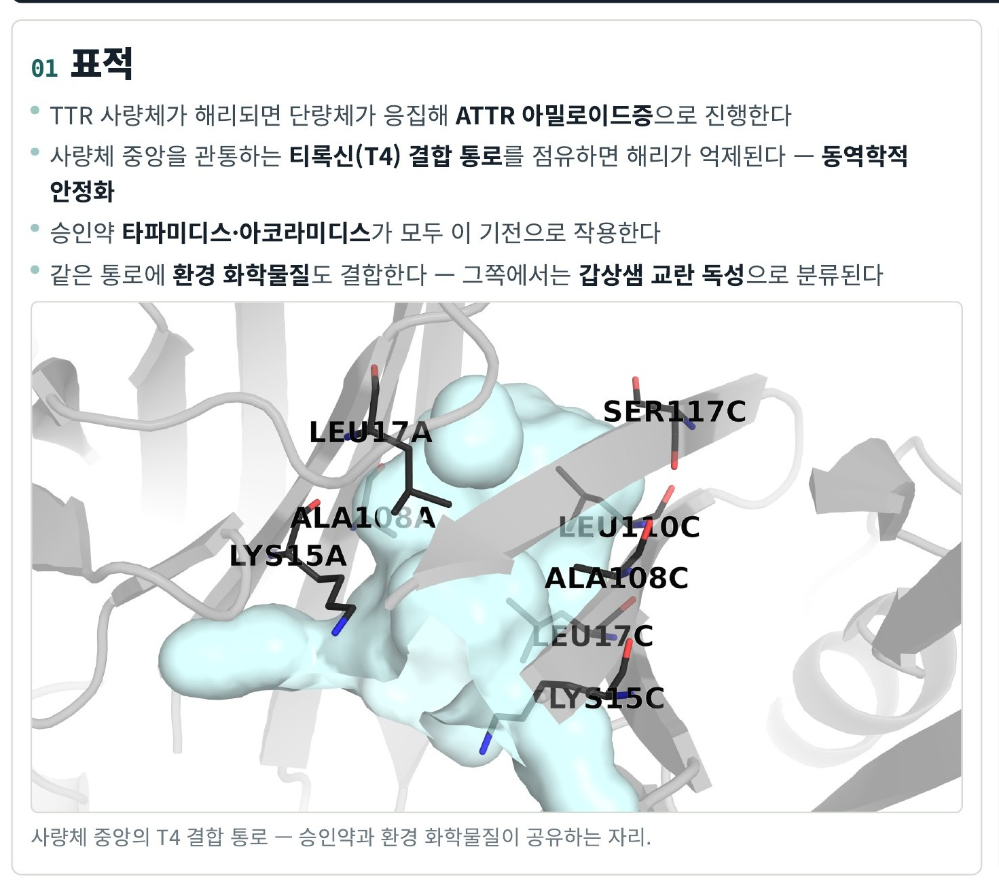
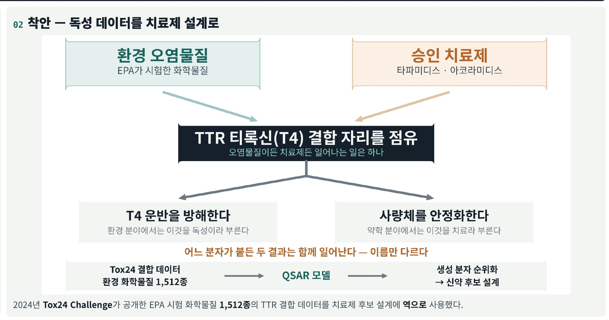
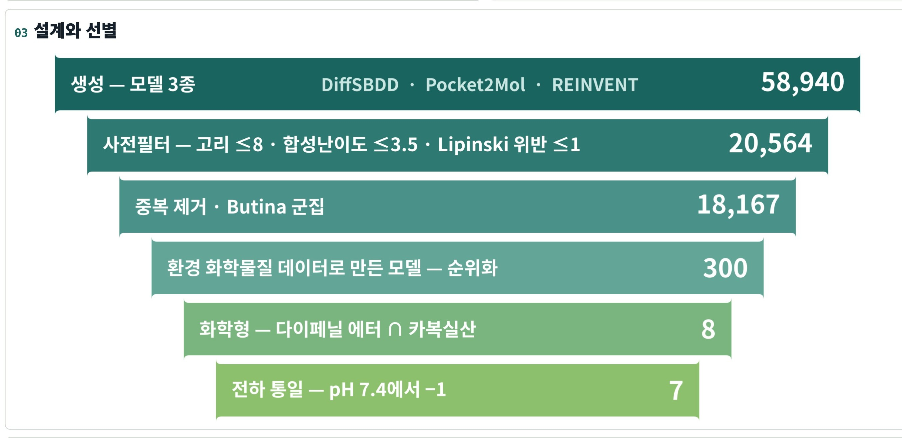
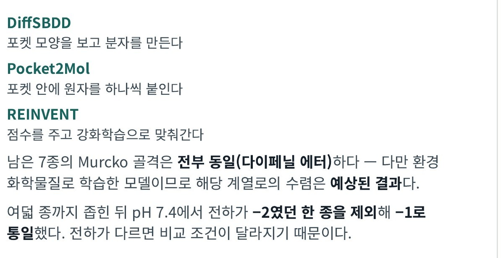
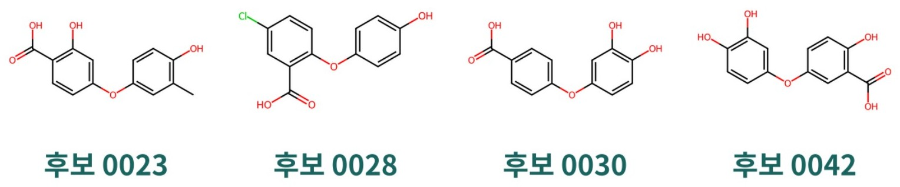
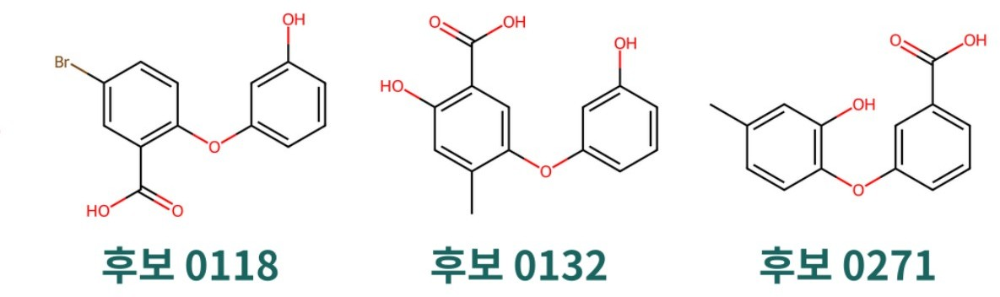
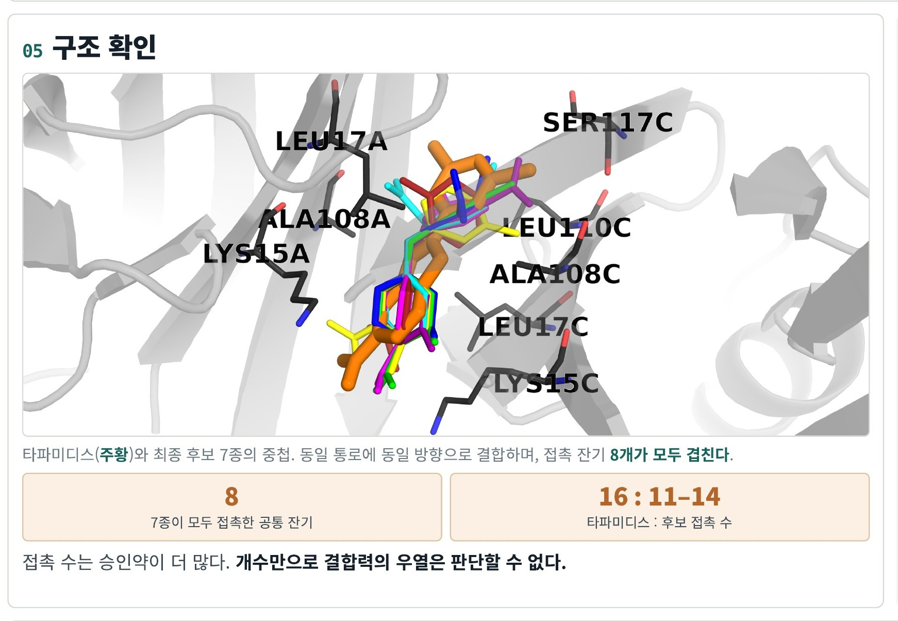
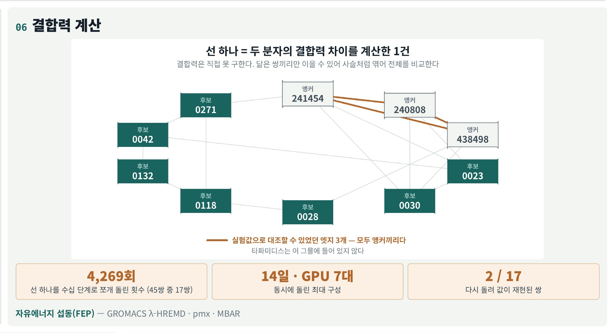
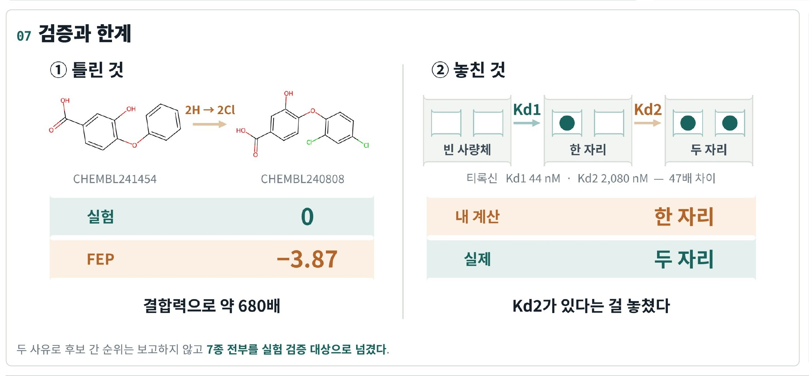
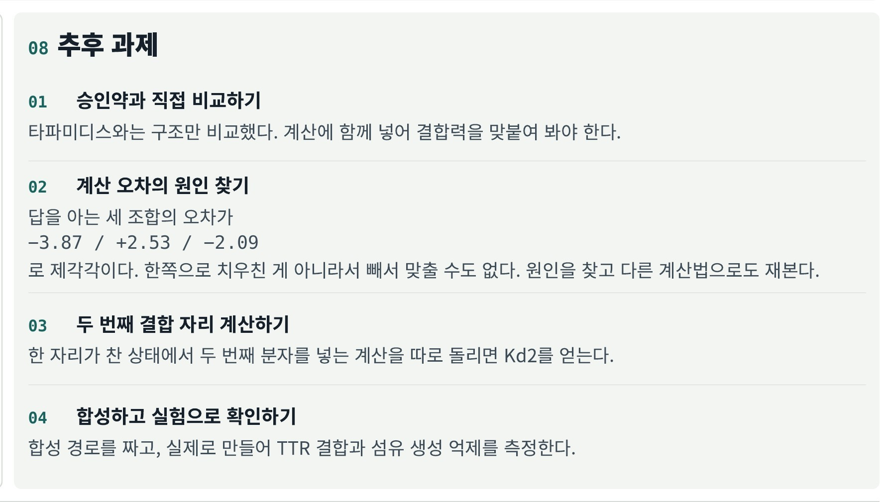

<h1>독성에서 치료제로</h1>

**환경 화학물질의 TTR 결합 데이터를 이용한 사량체 안정화제 후보 설계**

문승재 · 충북대학교 
대한약학회 80주년 기념 국제학술대회 포스터 발표 — 2026.10.24 · 950 × 1500 mm

> 환경 화학물질의 TTR 결합 데이터로 세운 QSAR 모델과 생성 모델 **3종**으로 **58,940종**을
> 설계해 **7종**을 선별했고, 일곱 모두 승인약 **타파미디스와 같은 결합 자리**를 점유했다.
> 다만 자유에너지 계산이 *답이 0인 대조 조합에서 −3.87 kcal/mol*을 내놓아 후보 간
> 순위 판정에 미달하므로 **순위는 보고하지 않는다**.

**[▶ 전체 PDF 내려받기](poster-2026-kps/out/TTR_포스터_95x150.pdf)**

---

아래는 같은 포스터를 블록 순서대로 확대한 것이다. 이미지를 누르면 원해상도로 열린다.

LYS15와 염다리 형성 4종 `0023` `0030` `0042` `0271` · 형성하지 않음 3종 `0028` `0118` `0132` —
번호는 선별 단계의 식별자이며 결합력 순위가 아니다. 결합 양상이 두 갈래로 갈려 양쪽을 모두 후보에 남겼다.

## 결론

환경 독성 평가용 데이터로 세운 모델을 치료제 후보 설계에 역으로 적용해 후보 7종을 얻었고,
구조적으로 승인약과 동일한 결합 자리 점유를 확인했다. 자유에너지 계산의 신뢰 구간이 순위
판정에 미달함을 대조 조합으로 확인하여, 순위 대신 **7종 전부**를 실험으로 넘겼다.

## 참고문헌

1. Palaninathan SK. *Curr Med Chem.* 2012;19(15).
2. Wiseman RL et al. *J Am Chem Soc.* 2005;127:5540.
3. Bulawa CE et al. *PNAS.* 2012;109:9629.
4. Tox24 Challenge, ochem.eu (2024).

---

## 포스터에 담지 못한 것

포스터는 벽 한 장이라 담을 수 있는 분량에 한계가 있다. 이 캠페인에는 포스터에
적지 않은 한계가 더 있고, 전부 아래 전체 기록에 측정값과 함께 적혀 있다.

- **후보를 고른 축이 목표 축으로 전이된다는 근거가 없다 — 0/9.**
  Tox24 결합 치환 %로 학습한 모델 9종을 피브릴 억제 pIC50(실측 64종)에 대해
  따로 평가했고, 아홉 모두 Spearman ρ의 신뢰구간이 0을 포함했다. 자유에너지
  계산의 실패보다 더 상류에 있는 한계다. → [전체 기록 §2-4](PROJECT.md)
- **후보를 모델이 발견했다고는 할 수 없다.** 18,167개 중 화학형 조건
  (디페닐에터 ∩ 카복실산)만 만족하는 것이 118개다. 좁힌 것은 모델이고 화학형을
  정한 것은 승인약 3종과 앵커 9개라는 외부 지식이다. → [§2-3](PROJECT.md)
- **도킹 점수는 이 표적에서 무작위 이하였다** (ROC-AUC 0.3484). 그래서 순위
  지표를 구조 기반에서 리간드 기반으로 교체했다. → [§2-2](PROJECT.md)
- **제출 초록과 그물이 다르다.** 초록은 전하 0층 12노드·19엣지 기준이고,
  최종 캠페인은 전하 −1층 10노드·17엣지다. 두 그물은 분자가 하나도 겹치지
  않는다. → [§6-3](PROJECT.md)

## 이 저장소

TTR 사량체 안정화제를 자유에너지 섭동(FEP)으로 고르려 한 기록이다.
파이프라인은 벤치마크 자격 검사를 통과했고, 본 시험은 통과하지 못했다.

| | |
|---|---|
| **[PROJECT.md](PROJECT.md)** | 전체 기록 — 목표·방법·단계별 결과·진단·재현 (7절) |
| **[poster-2026-kps/](poster-2026-kps/)** | 위 포스터의 원본 HTML·그림·인쇄용 PDF와 17엣지 원자료 |
| [01_tyk2_validation/](01_tyk2_validation/) | 벤치마크 검증 (관문 1) |
| [02_ttr_campaign/](02_ttr_campaign/) | 신규 표적 캠페인 · 사전 등재 문서 |
| [03_prevalidation/](03_prevalidation/) | 지표 사전 검증 |
| [figures/](figures/) | 그림 |

궤적·에너지 파일은 용량 때문에 넣지 않았고, 수치를 뒷받침하는 설정·스크립트·결과표만 올렸다.
