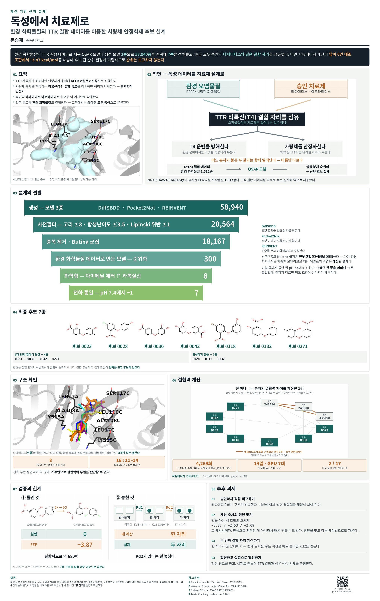

# 독성에서 치료제로 — TTR 사량체 안정화제 후보 설계

대한약학회 2026 추계학술대회 포스터 (2026-10-24) · 950 × 1500 mm

문승재 · 충북대학교



완성본: [`out/TTR_포스터_95x150.pdf`](out/TTR_포스터_95x150.pdf)

---

## 이 폴더에 있는 것

| 경로 | 내용 |
|---|---|
| `poster.html` | 포스터 본문. CSS `@page { size: 950mm 1500mm }` 단일 페이지 |
| `render.js` | Playwright로 HTML → PDF. 넘침(px)과 이미지 로드 여부를 같이 출력 |
| `build/mk_net.py` | `data/slide_edges.csv` → `fig/network.png` (06 블록의 섭동 그물) |
| `data/slide_edges.csv` | 17개 엣지의 회차별 ΔΔG · λ 사다리 · C6 판정 · 실험값 |
| `fig/` | 포스터가 참조하는 그림 8종 |
| `out/` | 인쇄용 PDF와 미리보기 JPG |

## 다시 만들기

```bash
npm i playwright          # 또는 기존 chromium 경로를 render.js 에 지정
python3 build/mk_net.py   # fig/network.png 재생성
node render.js            # out/TTR_포스터_95x150.pdf 생성
```

`render.js` 는 Chromium 실행 파일 경로가 `/opt/pw-browsers/chromium` 으로 박혀 있다.
다른 환경에서는 `executablePath` 를 지우거나 본인 경로로 바꾸면 된다.

출력은 **950.3 × 1500.3 mm 1페이지**여야 하고, 콘솔에 `넘침 0 px · 이미지 8/8` 이 떠야 한다.

---

## 계산 규모

포스터 06 블록의 숫자가 나온 근거다. 저장소 내 `md.log` 를 세어 집계했다.

| | 최종 17엣지 보고분 | 저장소 전체 (평형화·예비·폐기 포함) |
|---|---|---|
| `md.log` 수 | 4,269 | 24,523 (완주 23,870 / 끊김 653) |
| 실행 단위 | 4,444 | 25,212 |
| 분자 운동 합계 | 4,759.5 ns (4.76 µs) | 8,107.2 ns |
| 기간 | 2026-09-20 → 10-04 (14.15일) | 36.41일 |

호스트 10대, 각 GPU 1장, **동시 가동 최대 7대**.

벽시계 시간(wall-clock)은 집계하지 않았다. `-append` 로 재개한 회차는 앞 회차의
`Wall t` 줄이 잘려 과소 집계되고, `-multidir` 은 창마다 같은 벽시계 값을 적어 과대
집계된다. 구간을 좁혀도 488 h ~ 5,472 h 라 의미가 없어 포스터에서 뺐다.

TYK2 파일럿은 다른 트리(`TYK2-PILOT/`)에 있고 위 숫자에 포함하지 않았다.

---

## `data/slide_edges.csv` 열 설명

17행 + 헤더. 한 행이 엣지(= 두 분자의 결합력 차이를 계산한 1건) 하나다.

| 열 | 뜻 |
|---|---|
| `엣지` | N01 ~ N17 |
| `A_실행방향` / `B_실행방향` | 변환 시작 분자 / 도착 분자 |
| `더미_중원자_dummies_heavy` | pmx 혼성 토폴로지의 더미 중원자 수. 이 그물의 엣지 가중치 |
| `MCS_원자수_mcs_n` · `중원자_A` · `중원자_B` | 최대 공통 부분구조 / 양쪽 중원자 수 |
| `회차수_n` · `채점회차` | **채점에 쓴** 회차 수와 그 이름. 실제 실행 회차는 이보다 많을 수 있다 |
| `평균ΔΔG` · `회차간_표준편차_s` | kcal/mol |
| `C6_0.5_통과` | 회차 간 표준편차 ≤ 0.5 kcal/mol 이면 `통과`. **17개 중 2개만 통과** |
| `회차별_ΔΔG` | 회차 하나하나의 값 |
| `n-lambdas_복합체` / `n-lambdas_용매` | λ 사다리 구성 (결합/정전/반데르발스) |
| `창당_ns` | 한 단계당 생산 시간 |
| `실험ΔΔG` | 문헌 실험값. **3개 엣지만 보유**, 나머지는 `미보유` |

> `회차수_n` 은 채점 회차 수지 실행 회차 수가 아니다. 이 열로 총 시뮬레이션 양을
> 추정하면 과소 집계된다 — 위 표의 4,269 / 24,523 은 `md.log` 를 직접 센 값이다.

---

## 포스터에 적힌 한계

1. **답을 아는 대조 조합에서 오차가 났다.**
   실험ΔΔG 를 가진 엣지 3개(N01 · N04 · N07)로 앵커 3종의 값을 역산하면
   오차가 −3.867 / +2.532 / −2.087 kcal/mol 로 제각각이다. 한쪽으로 치우친
   계통 오차가 아니라서 빼서 맞출 수도 없다. 그래서 **후보 간 순위를 보고하지 않았다.**

2. **결합 자리가 하나가 아니다.**
   TTR 의 T4 결합 통로에는 자리가 둘 있고 리간드에 따라 협동성이 달라진다
   (티록신 Kd1 44 nM · Kd2 2,080 nM). 이번 계산은 한 자리만 채운 상태를 다뤘다.

3. **재현된 엣지가 2/17 이다.** 같은 엣지를 다시 돌렸을 때 값이 0.5 kcal/mol
   안으로 모인 경우가 2건뿐이다. 더 돌려야 한다.

4. **승인약 타파미디스는 이 그물에 없다.** 구조만 비교했고 자유에너지 계산에는
   넣지 않았다.
